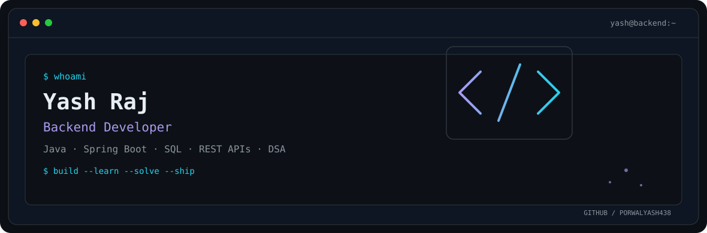
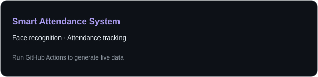
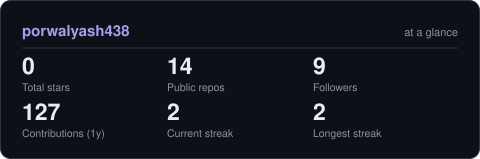
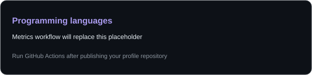

<picture>
  <source media="(prefers-color-scheme: dark)" srcset="assets/banner-dark.v9.svg">
  <source media="(prefers-color-scheme: light)" srcset="assets/banner-light.v9.svg">
  
</picture>

 

&nbsp;&nbsp;

 

---

## Hi, I'm Yash Raj 👋

I'm a backend-focused developer interested in building reliable applications and solving challenging programming problems. My core focus is **Java, backend engineering, databases, and problem-solving**.

- ☕ Working with Java, object-oriented programming, and data structures & algorithms.
- 🚀 Exploring backend development, REST APIs, SQL, and application architecture.
- 🧩 Solved **1,000+ programming problems** across coding platforms.
- 🏆 Achieved **Global Rank 1 in CodeChef Starters 186**.
- 🌱 Continuously improving my engineering fundamentals and building practical projects.

## Tech stack

---

## Skills at a glance

<table><tr>
<td width="50%" align="center" valign="middle">
<picture><source media="(prefers-color-scheme: dark)" srcset="assets/radar-dark.svg"><source media="(prefers-color-scheme: light)" srcset="assets/radar-light.svg"></picture>
</td>
<td width="50%" align="center" valign="middle">
<picture><source media="(prefers-color-scheme: dark)" srcset="assets/radar-langs-dark.svg"><source media="(prefers-color-scheme: light)" srcset="assets/radar-langs-light.svg"></picture>
</td>
</tr></table>

---

## Featured projects

### [Railway Reservation System](https://github.com/vManav123/railway-reservation-system)
A backend-oriented railway reservation project covering booking workflows and supporting services. The linked repository is maintained under the repository owner's GitHub account.

### [Smart Attendance System using Face Recognition](https://github.com/porwalyash438/Smart_Attendance_System_using_Face_Recognition)
An attendance project using facial recognition to automate attendance tracking.

<picture><source media="(prefers-color-scheme: dark)" srcset="assets/card-Smart_Attendance_System_using_Face_Recognition-dark.svg"><source media="(prefers-color-scheme: light)" srcset="assets/card-Smart_Attendance_System_using_Face_Recognition-light.svg"></picture>

---

## GitHub activity

<picture><source media="(prefers-color-scheme: dark)" srcset="assets/card-stats-dark.svg"><source media="(prefers-color-scheme: light)" srcset="assets/card-stats-light.svg"></picture>

> These statistics are refreshed by GitHub Actions after you publish the repository and enable the workflows.

---

Build · Learn · Solve · Ship — <a href="https://github.com/porwalyash438">@porwalyash438</a>

